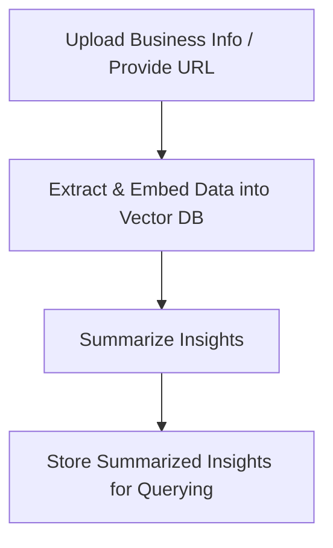
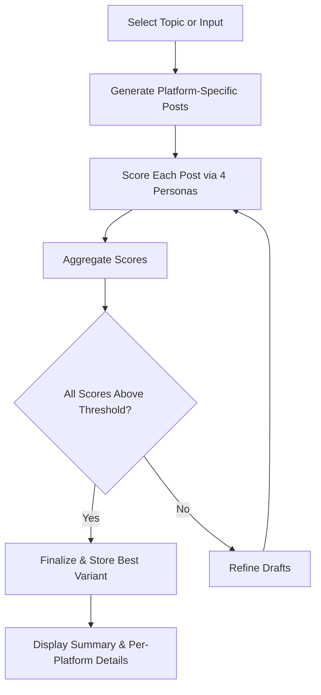
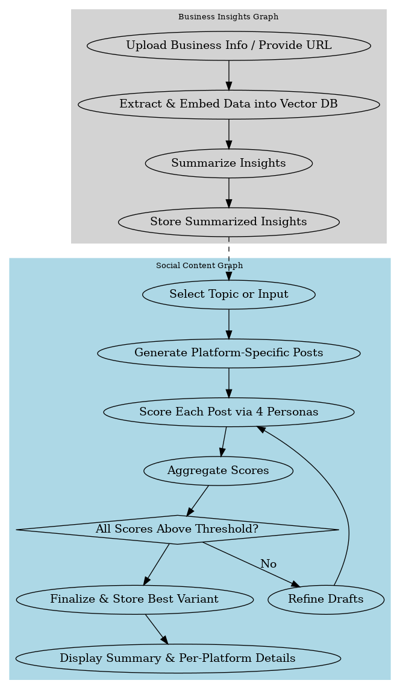
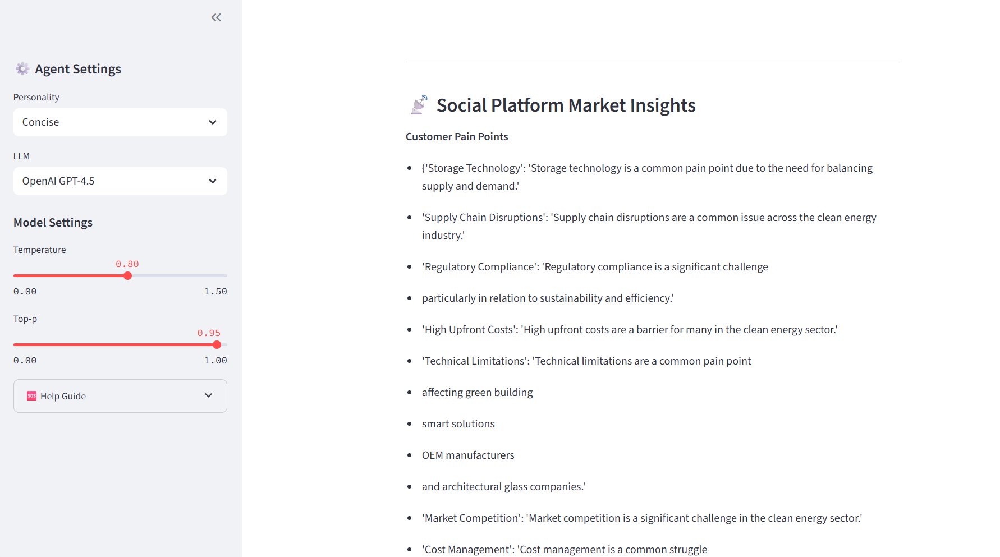
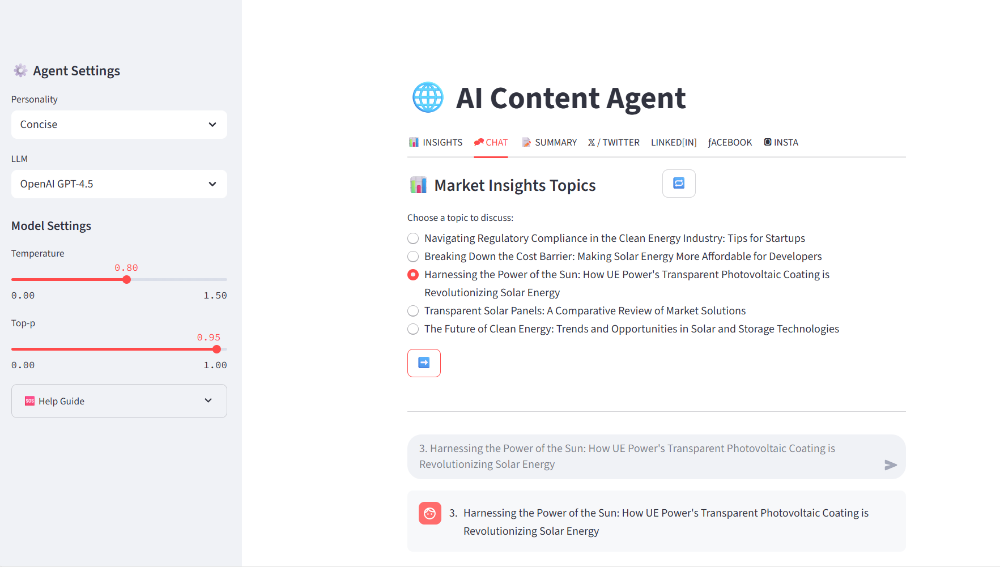
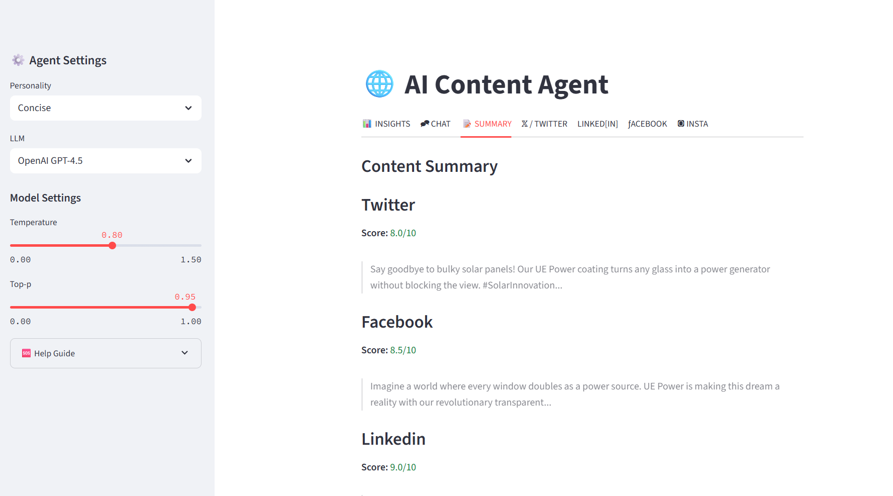
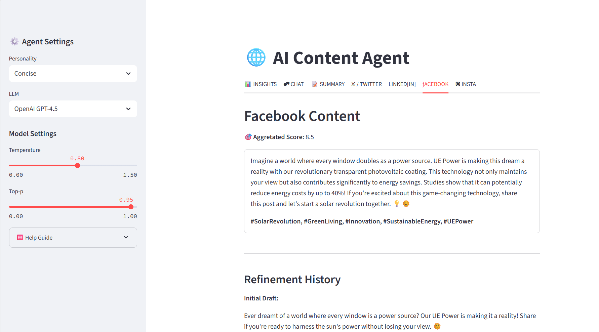

# PULSE


## Short
An AI-powered agentic application for **multi-platform content ideation, generation, scoring, and refinement**.  
The app uses **LangGraph** to orchestrate two main processes:  
1. **Business Insights Graph** – Summarizes uploaded business information and research market insights.  
2. **Social Content Graph** – Generates and refines social media posts around the brand and business insights for multiple platforms.

---

## Overview
This project is an AI-driven content creation and refinement tool designed to help businesses generate high-quality, platform-specific social media posts. Traditional content creation often results in generic, non-personalized messages that fail to engage target audiences.

This approach solves this by:

- Extracting and summarizing business insights from uploaded documents or URLs.

- Generating tailored content for multiple platforms (Twitter, LinkedIn, Facebook, Instagram).

- Scoring drafts through multiple AI personas (social strategist, industry expert, customer, investor) to evaluate clarity, engagement, and relevance.

- Iteratively refining low-scoring drafts until they meet quality thresholds.

- Presenting a concise summary and detailed per-platform view for immediate use.

- This ensures every piece of content is context-aware, brand-aligned, and optimized for engagement—significantly reducing manual work and improving output quality.

---

## Core Features

- Upload **business info, your pitch deck or business plan as PDFs or text**, provide a **URL to your website or about page** to extract insights and summarize them.
- Generate **customized market insights** from social platform data (e.g. Twitter, Reddit, Quora or YCombinator), about common pain points, target group, industry trends, competition and user feedback.

- Create **platform-specific content** for:
  - Twitter (Short, viral hooks)
  - Facebook (community-oriented)
  - LinkedIn (professional/thought leadership)
  - Instagram (visual/meme-oriented)

- Scoring posts with **Multi-persona LLM-as-a-Judge** 
- Four personas score content:
  - Social media Strategist (clarity, virality, brand fit)
  - Target Customer (pain points, relatability)
  - Industry Expert (accuracy, authority)
  - Investor (business value, growth potential)
- **Iterative refinement loop** until a quality threshold is reached.
- Summarized **overview tab** + detailed per-platform tabs with refinment history for direct copy.
- Full **real-time status updates** during graph execution using stream.
- Token counter for **total tokens** used and the **estimated price** in usd

---

## Architecture: Two Graphs Working Together

### 1. Business Insights Graph
- **Input:** Uploaded business documents and/or provide URL.
- **Steps:**
1. Extract and embed raw business data into vector DB.
2. Summarize insights for later use in content generation.
3. Store summarized insights for querying.

**Purpose:** Provides contextual knowledge for the Social Content Graph.



### 2. Social Content Graph
- **Input:** Selected topic or user input + summarized insights.
- **Steps:**
1. Generate 4 platform-specific posts in a single LLM call (JSON output).
2. Score each post via 4 personas (16 judgments total).
3. Aggregate scores; trigger refinement loop if below threshold.
4. Store refined drafts in history and finalize best variant.
5. Display summary + detailed breakdown per platform.



## Architecture Diagram


---

## Installation

```bash
git clone https://github.com/daytona675r/ContentAgent.git
cd ContentAgent
python3 -m venv venv
pip install -r requirements.txt
```

The supported runtime is Python 3.11+. For a credential-free portfolio
preview, run the deterministic replay UI:

```bash
DEMO_MODE=1 streamlit run app.py
```

Demo mode labels sample context, platform drafts and persona scores as
replayed data. It makes no OpenAI, Google or Tavily request. Real mode remains
local/private and reads provider credentials from environment variables.

The public replay demo offers three explicitly fictional briefs: a B2B onboarding
workspace for operations teams, a repairable commuter light, and a neighborhood
evening market. Each brief has authored platform-specific drafts, strategist
feedback and improved revisions. The real LangGraph runs end to end; provider
responses are deterministic sample data rather than live AI generation.

## Full-stack PULSE surface

The same deterministic workflow is available through a typed FastAPI boundary
and a small React/Vite frontend:

```text
React/Vite frontend -> FastAPI -> real LangGraph -> deterministic ReplayProvider
```

Run locally from a fresh checkout:

```bash
uvicorn api.main:app --reload --port 8000
cd frontend && npm install && npm run dev
```

Set `VITE_API_BASE_URL` at frontend build time when the API is hosted elsewhere.
The public demo executes the real LangGraph with deterministic simulated
provider adapters; it does not call OpenAI, Google or Tavily and no provider
credentials reach the browser. The Streamlit surface remains available as the
legacy/local UI.

`VITE_API_BASE_URL` is a Vite build-time variable. After Render creates the
public API service, set it to that HTTPS URL and rebuild the frontend. Set
`PULSE_ALLOWED_ORIGINS` to the exact deployed frontend origin plus
`http://localhost:5173`; it is intentionally not a wildcard.

### Live portfolio demo (Render)

- **[Open the PULSE React demo](https://pulse-demo-web.onrender.com)**
- [FastAPI health endpoint](https://pulse-demo-api-iwj4.onrender.com/health)
- [Hosted end-to-end smoke check](https://github.com/daytona675r/ContentAgent/actions/workflows/hosted-smoke.yml)

The hosted React app talks to a public FastAPI service and executes **the real
LangGraph orchestration** using the deterministic `ReplayProvider`. Generation,
evaluation, refinement and finalization run without external OpenAI, Google,
Tavily or other paid-model calls. Example output and demo token/cost figures
are simulated; this is not a live-LLM demonstration. The Streamlit UI remains
the legacy/local surface. No provider secrets are required on Render.

[`render.yaml`](render.yaml) documents the two Render services. They were
provisioned individually in Frankfurt/the Render static CDN using the same
service settings, and auto-deploy from `main`. The deployed configuration is:

- Frontend build-time `VITE_API_BASE_URL=https://pulse-demo-api-iwj4.onrender.com`
- Backend `PULSE_ALLOWED_ORIGINS=https://pulse-demo-web.onrender.com,http://localhost:5173`
- Backend `DEMO_MODE=true`, `PYTHON_VERSION=3.11.11`, `pip install -e .`

To independently verify the hosted flow, run:

```bash
API_URL=https://pulse-demo-api-iwj4.onrender.com \
FRONTEND_URL=https://pulse-demo-web.onrender.com \
bash scripts/deployment_smoke.sh
```

Alternatively, manually run `PULSE Hosted Smoke` in GitHub Actions; it
additionally checks deployed CORS response headers and the frontend bundle's
API endpoint. Render Free services can spin down after inactivity, so the
first request after an idle period may take longer. The public demo is a
portfolio showcase, not an SLA-backed production service.

**Environment variables (set in `.env`):**
```
OPENAI_API_KEY=your-key
GOOGLE_API_KEY=your-key
TAVILY_API_KEY=your-key for researching insights
```

---

## Running the App

```bash
streamlit run app.py
```

---


## Usage Guide

1. **Upload Business Info**  
   Go to the Insights tab and upload PDFs or text describing your company.
   Provide a link to your product website or about page.  
   The system summarizes and stores this in the vector DB.

2. **Generate Market Insights**  
   Then the Insights Graph is triggered to analyze trends and store structured insights.

3. **Select or Input Topic**  
   In the Chat tab pick from generated topics based around your business or enter your own.

4. **Generate Content**  
   The Social Content Graph creates posts for Twitter, Facebook, LinkedIn, and Instagram.

5. **Scoring & Refinement**  
   A Multi-persona judging loop refines until acceptable scores are reached.

6. **View Results**  
   The Summary tab gives an overview; the detailed tabs show full drafts to copy and the refinement history together with scores.

---

## Badges & Tech

- **LLM Orchestration:** LangGraph
- **Frontend:** React/Vite (public demo); Streamlit (legacy/local surface)
- **Storage:** Vector DB (Chroma)
- **Evaluation:** LLM-as-a-Judge with multi-persona perspectives
- **LLMs:** OpenAI GPT models (gpt-4 for generation/scoring, gpt-3.5 optional for cheaper tasks, Gemini)

---

## App Screenshots





---

## License

MIT License. See LICENSE for details.
