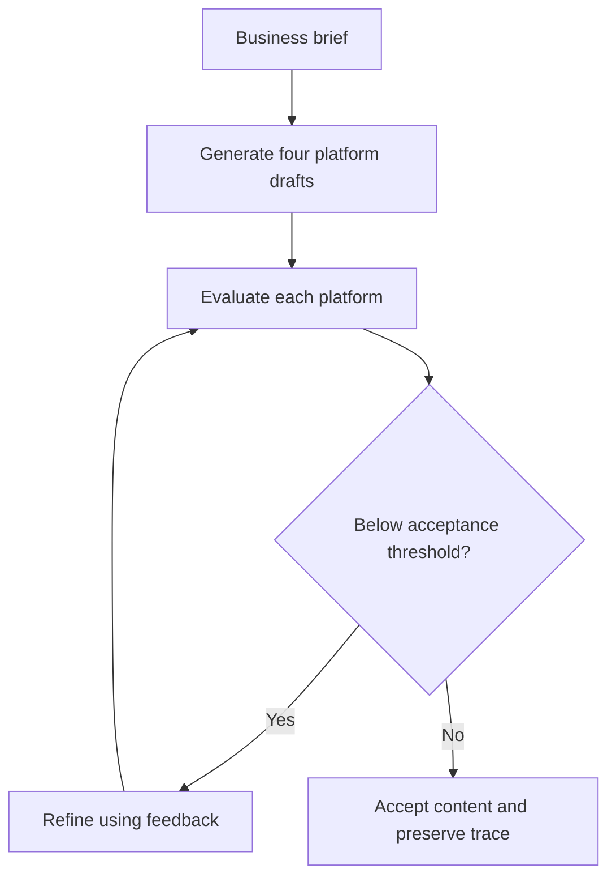

# PULSE

**A LangGraph workflow for generating, evaluating, and refining platform-specific content.**

**[Try the live demo](https://pulse-demo-web.onrender.com)** · [Source code](https://github.com/daytona675r/ContentAgent) · [Hosted smoke tests](https://github.com/daytona675r/ContentAgent/actions/workflows/hosted-smoke.yml)

PULSE explores a practical engineering question: **how do you turn variable AI-generated drafts into an inspectable workflow with explicit evaluation and revision steps?**

Given a business brief, the workflow produces posts for X/Twitter, LinkedIn, Facebook, and Instagram; evaluates each draft; revises below-threshold results; and retains the before/after trace.

## Explore the demo

Choose one of three **fictional** briefs:

- **Launchpath:** a B2B onboarding workspace for operations teams
- **Switchback:** a repairable commuter light
- **Night Market North:** a neighborhood evening market

For each platform, inspect the **initial draft → strategist feedback and score → revised post → accepted score**. You can see what changed and why, rather than receiving only a final answer.

> **What is real vs. simulated?** The public demo runs the actual FastAPI → LangGraph orchestration and evaluation/refinement branches. The `ReplayProvider` supplies **pre-authored, deterministic** example posts, feedback, and scores. No live LLM generates or judges these posts; displayed token/cost values are illustrative. No OpenAI, Google, or Tavily credentials are needed.

## Architecture

**React + TypeScript (Vite)** → **FastAPI** → **LangGraph** → **pluggable provider**



The same graph runs with an injected provider. The public demo substitutes authored responses at the provider boundary instead of replacing graph execution with a static API response.

**Implementation details worth inspecting:**

- **Graph and gates:** [`social_content_graph.py`](src/agent/social_content_graph.py) coordinates generation, scoring, conditional refinement, re-scoring, and finalization.
- **Provider boundary:** [`demo_provider.py`](src/agent/demo_provider.py) supplies repeatable scenario-specific responses without external keys.
- **API contracts:** [`api/main.py`](api/main.py) exposes typed scenario/result endpoints, validates scenario IDs, and reports workflow failures explicitly.
- **Client:** [`frontend/src`](frontend/src) renders per-platform draft, critique, refinement, and accepted score.
- **Verification:** tests cover contracts, graph flow, frontend rendering, and the deployed API/frontend integration.

The hosted example uses **one simulated strategist evaluator**. Multi-persona LLM prompts and business-insight experiments remain in the older codebase; they are **not** demonstrated as live AI features in the public deployment.

## Run locally

Requires **Python 3.11–3.13** and **Node.js 24** (the version used by CI).

**Terminal 1 — API**

```bash
git clone https://github.com/daytona675r/ContentAgent.git
cd ContentAgent
python -m venv .venv
source .venv/bin/activate  # Windows PowerShell: .venv\Scripts\Activate.ps1
python -m pip install -e .
python -m uvicorn api.main:app --reload --port 8000
```

**Terminal 2 — frontend**

```bash
cd ContentAgent/frontend
npm ci
npm run dev
```

Open `http://localhost:5173`. The frontend defaults to `http://localhost:8000` for local API calls. Both services work in deterministic demo mode without provider secrets.

## Deployment and verification

- **Frontend:** [pulse-demo-web.onrender.com](https://pulse-demo-web.onrender.com)
- **API:** [pulse-demo-api-iwj4.onrender.com](https://pulse-demo-api-iwj4.onrender.com) ([health](https://pulse-demo-api-iwj4.onrender.com/health))
- **Render configuration:** [`render.yaml`](render.yaml) documents the backend and static frontend; the live services were provisioned separately with equivalent settings.

`VITE_API_BASE_URL` is the public API HTTPS URL **at frontend build time**. `PULSE_ALLOWED_ORIGINS` contains the allowed frontend origins. The hosted service uses `DEMO_MODE=true`; no model-provider keys are configured.

Run the public integration check:

```bash
API_URL=https://pulse-demo-api-iwj4.onrender.com \
FRONTEND_URL=https://pulse-demo-web.onrender.com \
bash scripts/deployment_smoke.sh
```

Or inspect the GitHub Actions checks: [Quality](https://github.com/daytona675r/ContentAgent/actions/workflows/quality.yml) · [Portfolio Acceptance](https://github.com/daytona675r/ContentAgent/actions/workflows/portfolio-acceptance.yml) · [Hosted Smoke](https://github.com/daytona675r/ContentAgent/actions/workflows/hosted-smoke.yml).

Render's free backend can sleep when idle, so the first request may take longer. The demo is a portfolio showcase, not an always-on production service.

<details>
<summary>Original Streamlit prototype</summary>

The original [`app.py`](app.py) includes a separate Streamlit interface and earlier business-insights/model-backed experiments. It is retained as legacy code and is **not** the React demo linked above.

Run its credential-free sample view with:

```bash
DEMO_MODE=1 streamlit run app.py
```

The older screenshots in [`static/`](static/) depict this prototype, not the public React UI.

</details>

## License

[MIT](LICENSE).
